# StudySpace AI – Personal AI-Powered Study Assistant

## Project Overview

StudySpace AI is an AI-powered personal study assistant designed to help students organize their academic activities, plan study schedules, monitor learning progress, and improve their preparation through AI-based learning support.

## Features

- Dashboard with study progress overview
- Study task management
- Subject and syllabus tracking
- Daily study tracker
- AI-powered study planner
- AI study chatbot
- Automatic quiz generation
- Smart flashcards
- Exam countdown
- Weekly study analytics
- Achievement tracking
- Focus timer

## Technology Stack

- Python
- Streamlit
- SQLite
- Google Gemini API
- Ollama (Local LLM)

## Project Structure

- `app.py` – Main Streamlit application
- `database.py` – Core database operations
- `ai_engine.py` – AI provider integration
- `study_features_db.py` – Additional study feature database operations
- `requirements.txt` – Project dependencies
- `screenshots/` – Application screenshots

## Installation and Setup

1. Clone the repository:

   ```bash
   git clone https://github.com/indlashalini/StudySpace-AI-Personal-Study-Assistant.git
   ```

2. Navigate to the project folder:

   ```bash
   cd StudySpace-AI-Personal-Study-Assistant
   ```

3. Create and activate a Python virtual environment.

4. Install the required dependencies:

   ```bash
   python -m pip install -r requirements.txt
   ```

5. Create a `.env` file in the project folder and add your Gemini API key:

   ```env
   GEMINI_API_KEY=your_api_key_here
   ```

6. Start the application:

   ```bash
   python -m streamlit run app.py
   ```

## AI Providers

StudySpace AI supports two AI providers:

- **Google Gemini:** Cloud-based AI generation for study planning, quizzes, and learning assistance.
- **Ollama:** Local LLM integration for offline AI generation when the local model is installed and running.

## Database

SQLite is used to store study tasks, subjects, syllabus topics, study sessions, quiz results, flashcards, and exam information.

## Application Screenshots

Explore the interface and key features of StudySpace AI.

### 1. Main Dashboard

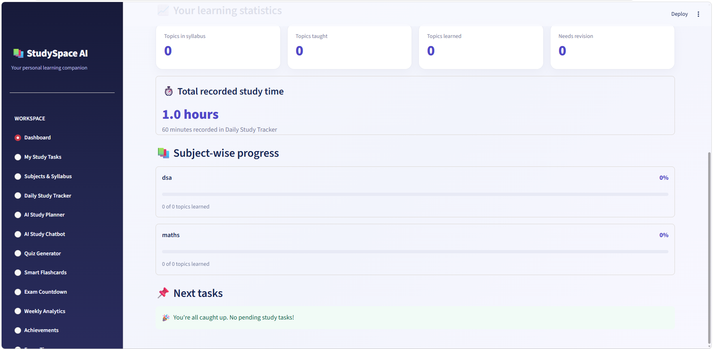

### 2. Study Overview


### 3. AI-Powered Study Planner

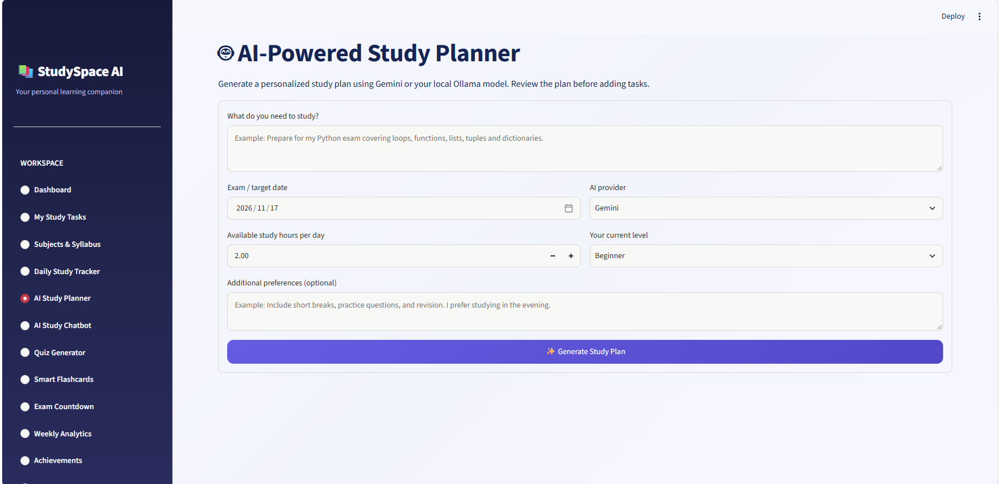

### 4. AI Study Chatbot

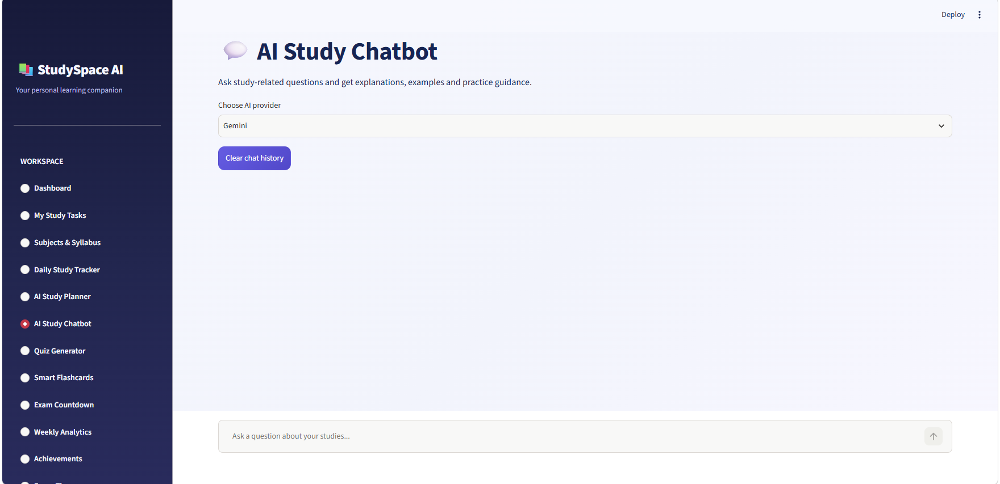

### 5. AI Quiz Generator

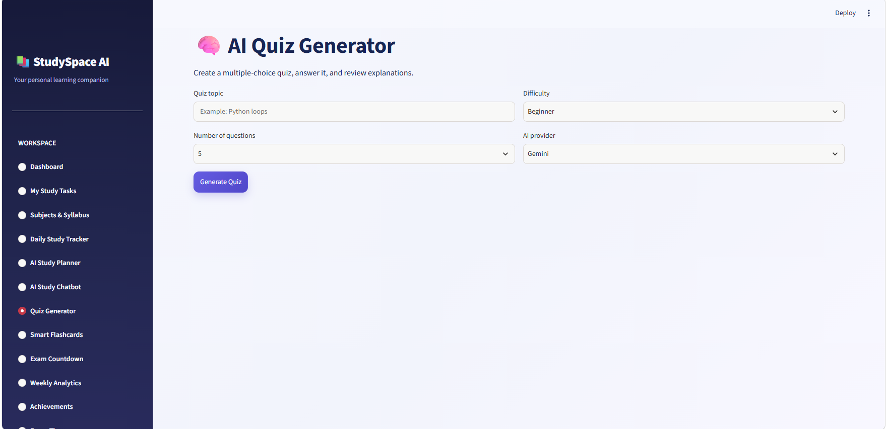

### 6. Daily Study Tracker

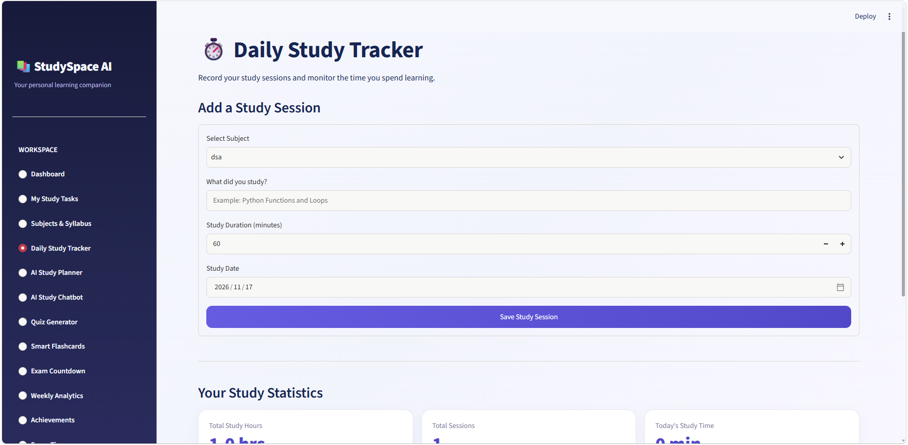

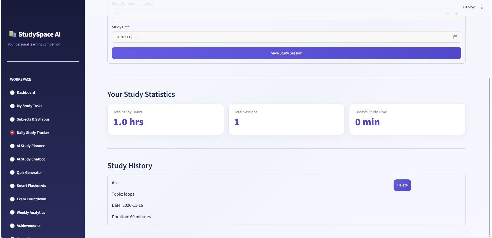

### 7. Study Tasks

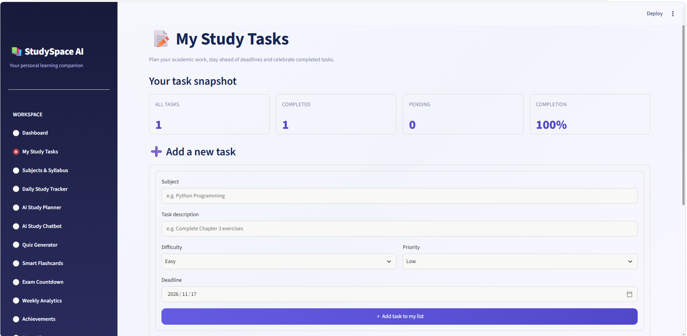

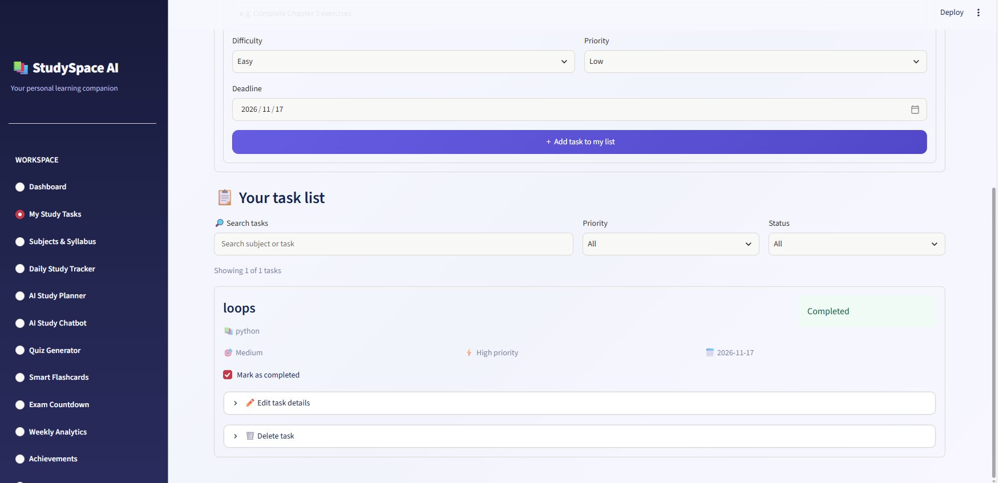

### 8. Subject and Syllabus Management

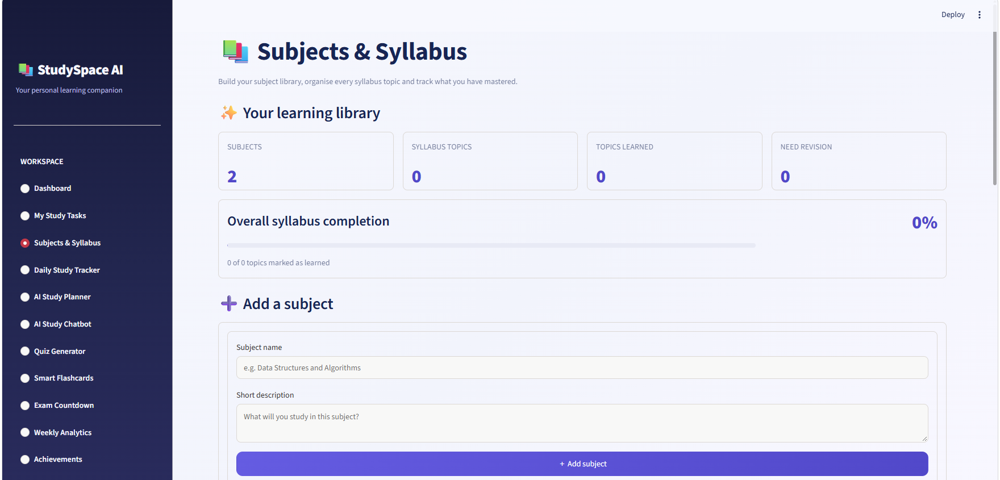

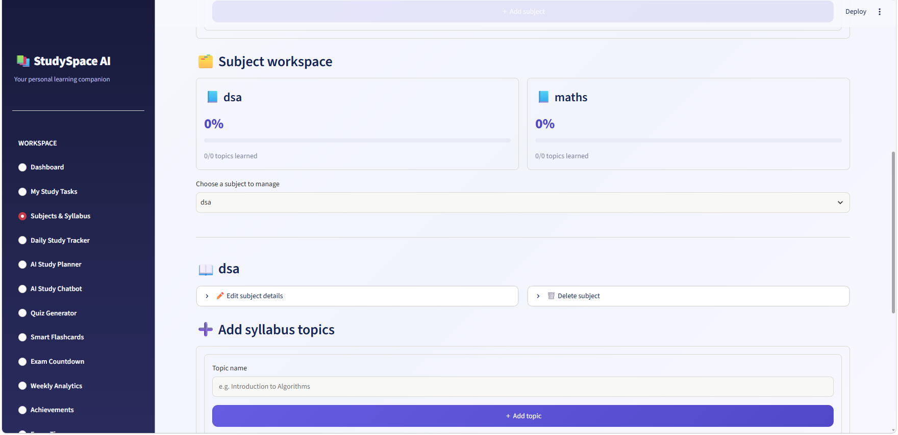

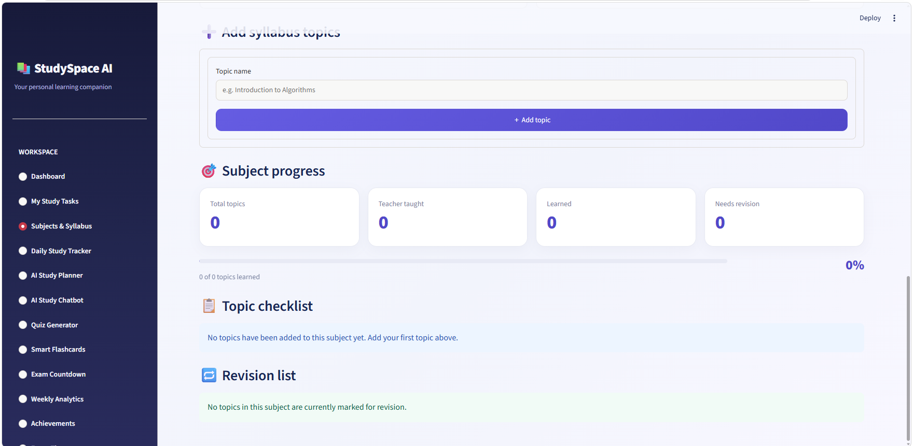

### 9. Smart Flashcards

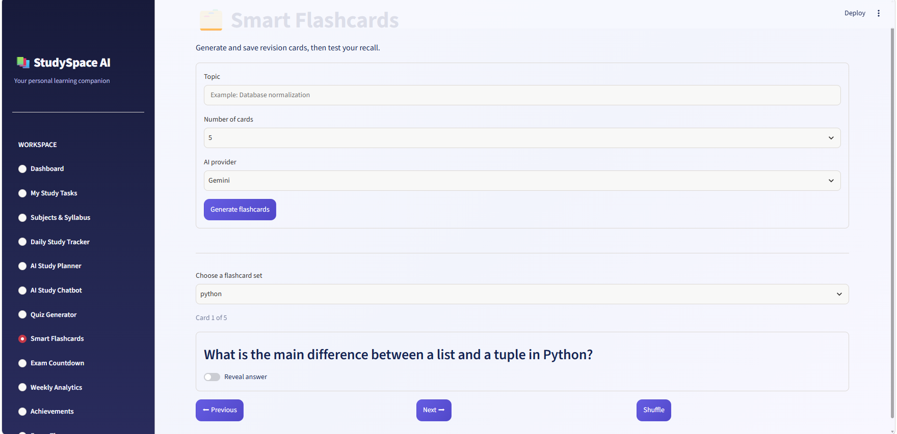

### 10. Focus Timer

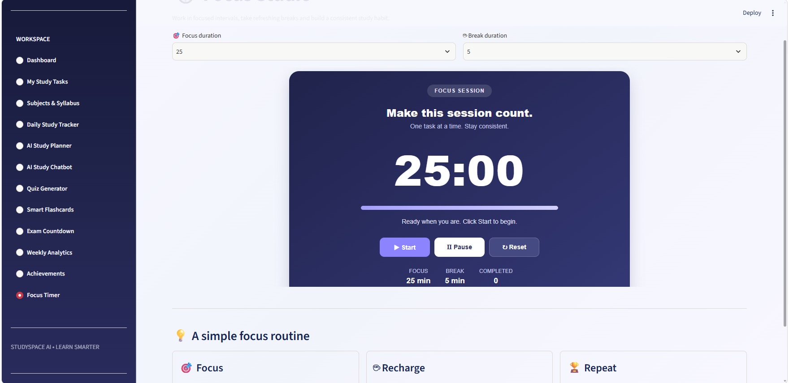

### 11. Exam Countdown

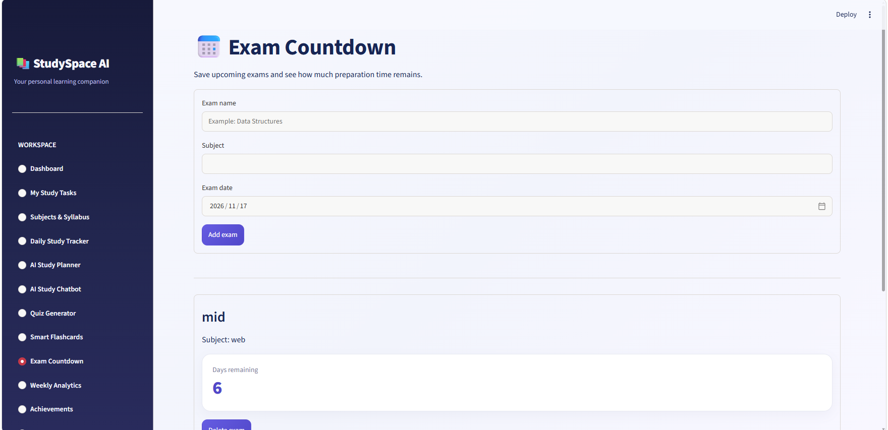

### 12. Achievements

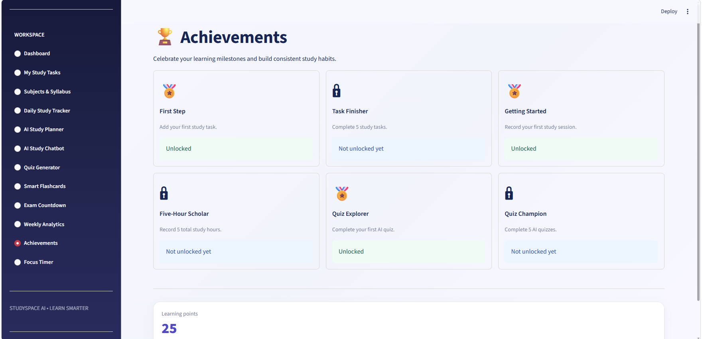

### 13. Weekly Study Analytics

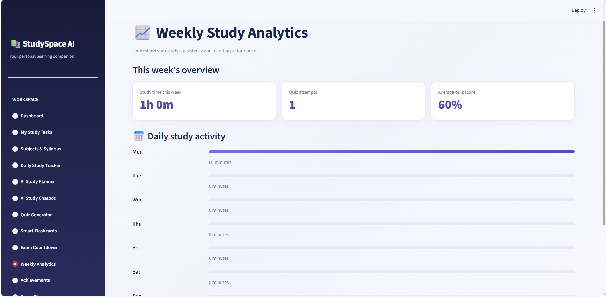

## Project Purpose

The project demonstrates how AI agents and Python-based application logic can support personalized student learning and academic planning.

## Author

Student Project – AI Agents

## GitHub Repository

[StudySpace AI – Personal AI-Powered Study Assistant](https://github.com/indlashalini/StudySpace-AI-Personal-Study-Assistant)